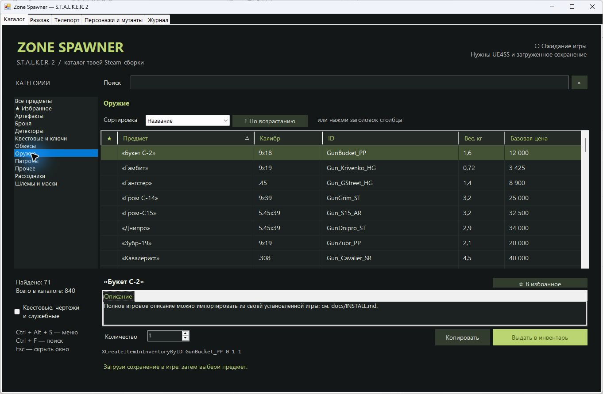
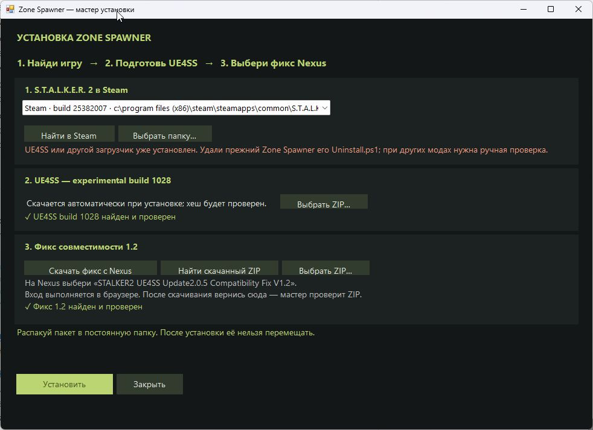
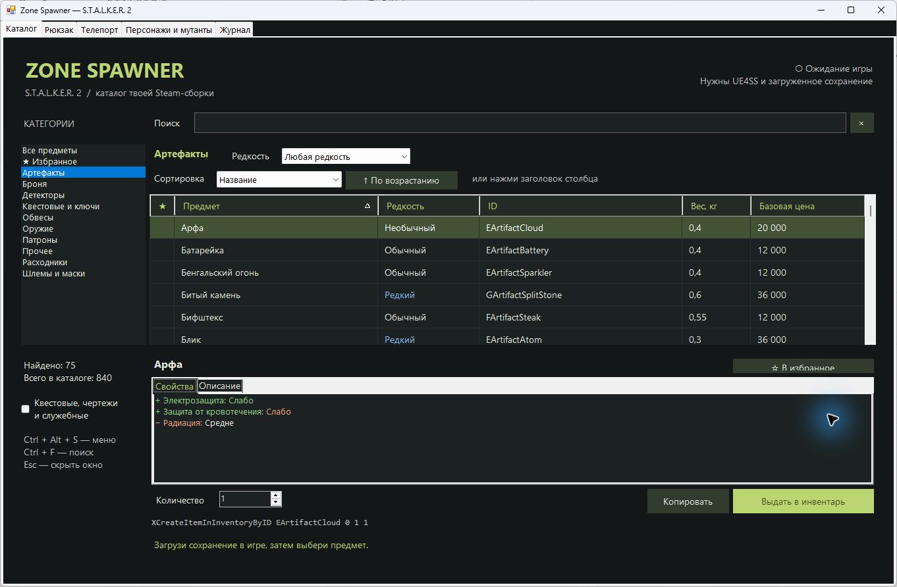
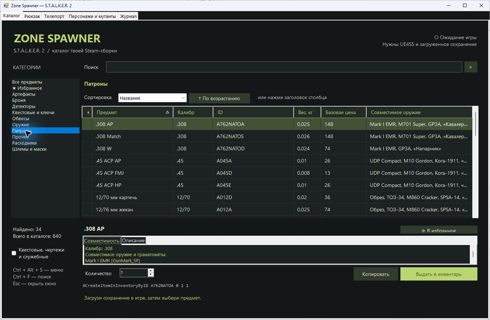
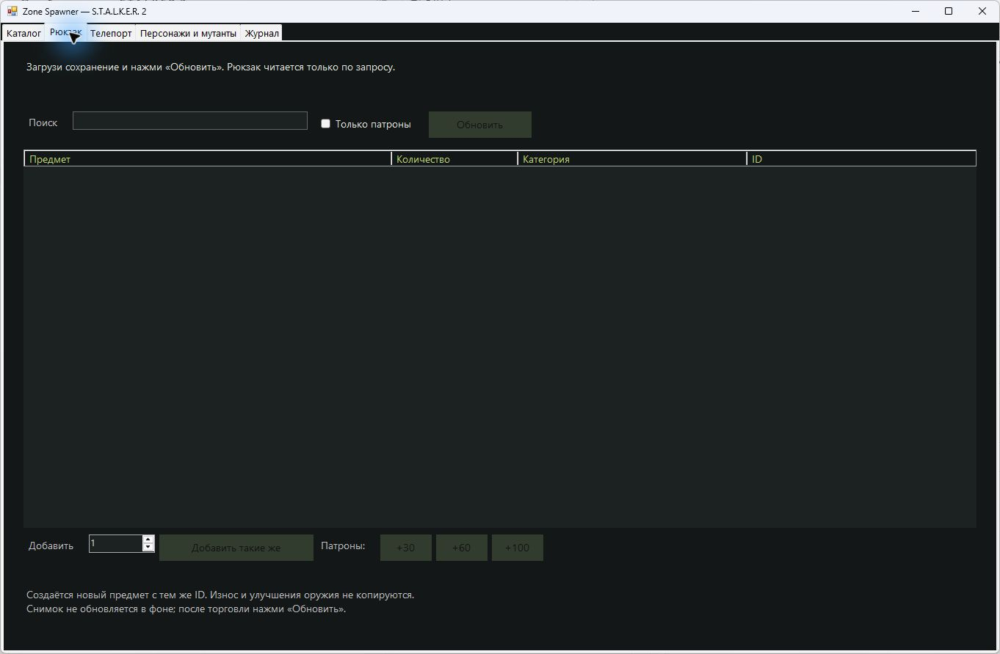
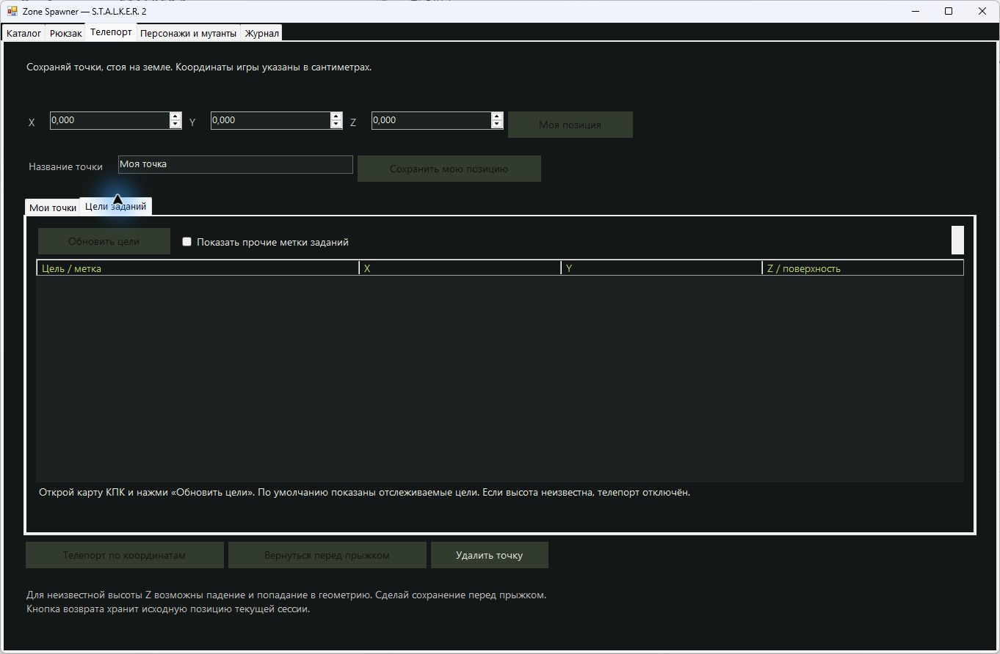
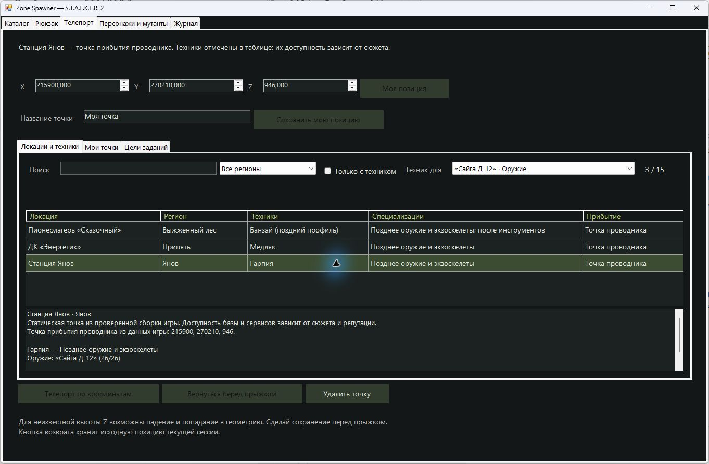
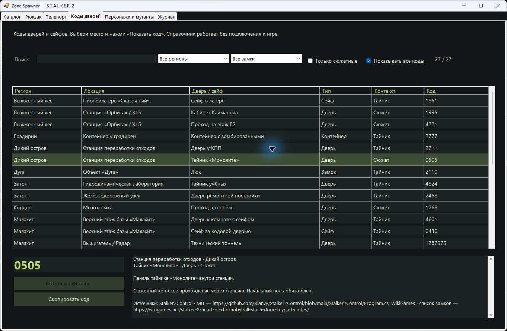
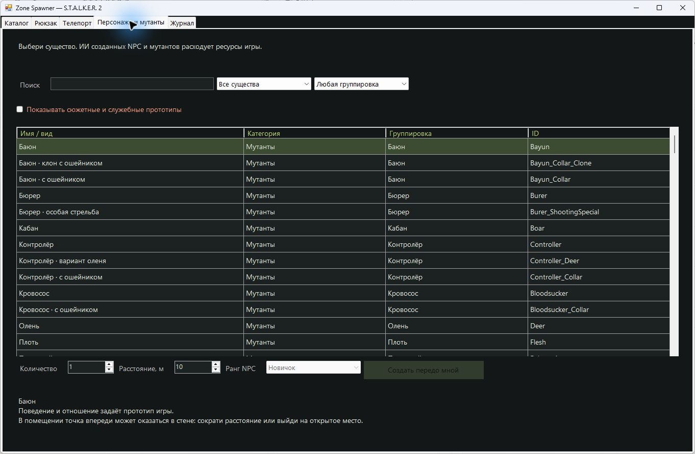

# Zone Spawner — меню для S.T.A.L.K.E.R. 2

Добавляй предметы в рюкзак, пополняй патроны, сохраняй точки телепортации и находи коды дверей. Это отдельное окно Windows с интерфейсом на русском языке, которое запускается вместе с игрой.

**[Скачать Zone Spawner 0.4.3 для Windows — ZIP](https://github.com/sergeysrnd/zone-spawner-stalker2/releases/download/v0.4.3-preview/ZoneSpawner-v0.4.3-preview-win64.zip)** · [Страница релиза](https://github.com/sergeysrnd/zone-spawner-stalker2/releases/tag/v0.4.3-preview)

**Совместимость:** нужна Steam-версия игры для Windows x64. Установщик проверен для сборки Steam **25382007** (UE **5.5.4**) и проверяет твою игру автоматически. Другие обновления игры пока не подтверждены. Это предварительная версия мода.

## Первый запуск

1. **Скачай ZIP по ссылке выше** и полностью распакуй его в постоянную папку, например `D:\Mods\ZoneSpawner`.
2. **Закрой игру и запусти `ZoneSpawner.Setup.exe`.** Мастер найдёт игру в Steam. Если нужно, укажи её папку кнопкой **«Выбрать папку…»**.
3. **Нажми «Скачать фикс с Nexus».** На открывшейся странице скачай файл **STALKER2 UE4SS Update2.0.5 Compatibility Fix V1.2** и вернись в мастер. Для скачивания может понадобиться учётная запись Nexus Mods.
4. **Нажми «Установить».** Мастер сам скачает загрузчик модов UE4SS и поставит его вместе с нужным исправлением и спаунером.
5. **Запусти игру через Steam, загрузи сохранение и нажми Ctrl + Alt + S.** В меню появится статус **«Игра подключена»**.

После установки оставь папку Zone Spawner на прежнем месте: игра использует файлы из неё. В дальнейшем запускай игру обычным способом — меню запустится и закроется вместе с ней.

**Меню уже установлено?** Открой [инструкцию обновления](docs/INSTALL.md#update). Если мастер сообщает о другой сборке или уже установленном UE4SS, смотри [решения частых проблем](docs/TROUBLESHOOTING.md).

## Что можно делать

| Задача | Где найти |
| --- | --- |
| Выдать оружие, броню, аптечки или патроны | **Каталог** → найди предмет → выбери количество → **«Выдать в инвентарь»** |
| Сравнить артефакты | **Каталог → Артефакты**: редкость и свойства в карточке |
| Подобрать патроны или обвес | **Каталог → Патроны / Обвесы**: калибр и список совместимого оружия |
| Добавить такие же вещи, как в рюкзаке | **Рюкзак**: выбери предмет и нажми **«Добавить такие же»**; для патронов есть **+30 / +60 / +100** |
| Переместиться к базе или своей точке | **Телепорт**: выбери локацию либо сохранённую позицию; есть возврат перед последним прыжком |
| Найти техника для своего снаряжения | **Телепорт → Локации и техники → «Техник для»** |
| Посмотреть метки текущих заданий | Открой карту КПК, затем **Телепорт → Цели заданий → «Обновить цели»** |
| Найти код двери или сейфа | **Коды дверей** → найди место → **«Показать код»** или **«Скопировать код»** |
| Создать персонажа или мутанта | **Персонажи и мутанты**: выбери вид, количество и расстояние появления |

По умолчанию каталог показывает 300 обычных предметов. Квестовые вещи и дополнительные варианты включаются отдельно. Подробные примеры: [руководство игрока](docs/USAGE.md).

## Управление

| Действие | Клавиши |
| --- | --- |
| Открыть или скрыть меню | **Ctrl + Alt + S** |
| Перейти к поиску на открытой вкладке | **Ctrl + F** |
| Скрыть окно меню | **Esc** |

Крестик тоже скрывает окно. Для полного выхода нажми правой кнопкой на значок Zone Spawner возле часов Windows и выбери **«Завершить»**. Автозапуск Windows для работы мода не нужен.

## Как выглядит меню

Показать остальные скриншоты

### Установка

На этом снимке мастер обнаружил действующий загрузчик и остановил повторную установку — это защита от перезаписи.

### Артефакты и совместимость патронов

### Рюкзак и цели заданий

Эти два снимка сделаны при закрытой игре: данные рюкзака и заданий появляются после подключения к загруженному персонажу.

### Локации, техники и коды дверей

### Персонажи и мутанты

## Что важно знать

- **Рюкзак обновляется по запросу.** После торговли или использования вещей нажми «Обновить». «Добавить такие же» создаёт новый предмет: износ и улучшения оружия не копируются.
- **Телепорт требует подходящей точки.** Есть 12 готовых точек прибытия; для Икара, Шевченко и НИИЧАЗ доступен справочник без готового прыжка. У целей заданий пока показываются тип и номер метки; при неизвестной высоте прыжок отключён. [Подробнее о телепорте](docs/USAGE.md#teleport).
- **Калибры, совместимость и возможности техников — справочные данные.** Изменённое у техника оружие и предметы других модов могут отличаться; чертежи и сюжет влияют на доступные улучшения.
- **Коды вводятся игроком.** Они не заменяют ключи и нужный этап задания. В справочнике 27 замков; каждый из них в текущем патче отдельно не проверен. [Подробнее о кодах](docs/DOOR_CODES.md).
- **Созданные персонажи и мутанты нагружают игру.** В помещении они могут не появиться. Копия сюжетного персонажа не восстанавливает связанные с ним задания.

Скрытое меню не запускает постоянный поиск игровых объектов. Рюкзак и метки заданий читаются по запросу; справочники предметов, локаций и кодов работают локально. В одном коротком замере чтение рюкзака не показало снижения среднего FPS; это не гарантия для всех сцен. [Условия замера](Производительность.txt).

## Помощь и подробности

- [Установка, обновление и удаление](docs/INSTALL.md)
- [Руководство игрока](docs/USAGE.md)
- [Меню не открывается и другие неполадки](docs/TROUBLESHOOTING.md)
- [Что изменилось в версиях](CHANGELOG.md)
- [Сообщить о проблеме](https://github.com/sergeysrnd/zone-spawner-stalker2/issues)

Для разработчиков: [сборка и устройство проекта](docs/DEVELOPMENT.md), [источники данных](THIRD_PARTY_NOTICES.md), [лицензия MIT](LICENSE). Zone Spawner — независимый проект, не официальный продукт GSC Game World.

**English:** A Russian-language Windows menu for the supported Steam version of S.T.A.L.K.E.R. 2: item spawning, ammo compatibility, backpack, teleports, technicians and door codes. [Download 0.4.3](https://github.com/sergeysrnd/zone-spawner-stalker2/releases/tag/v0.4.3-preview). See the compatibility note above before installing.
