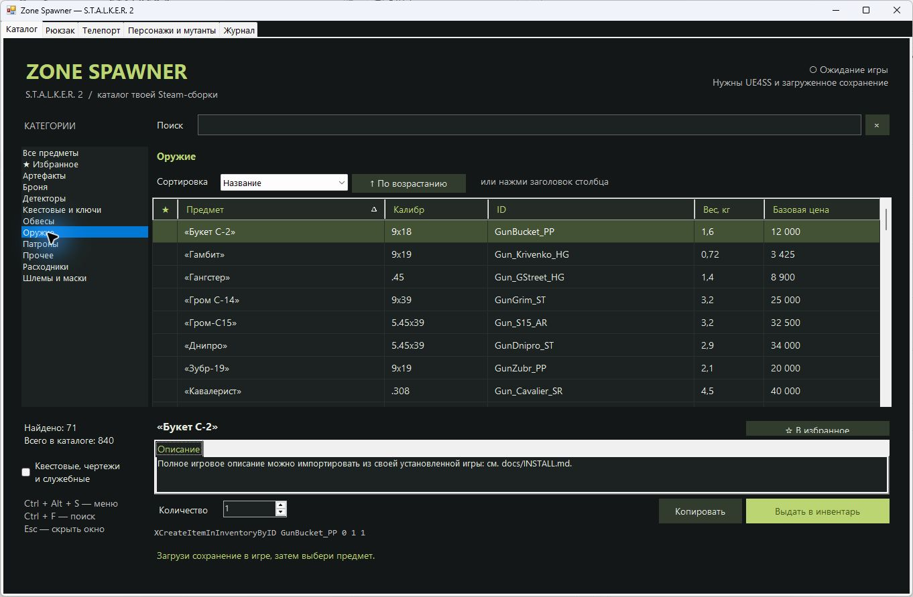
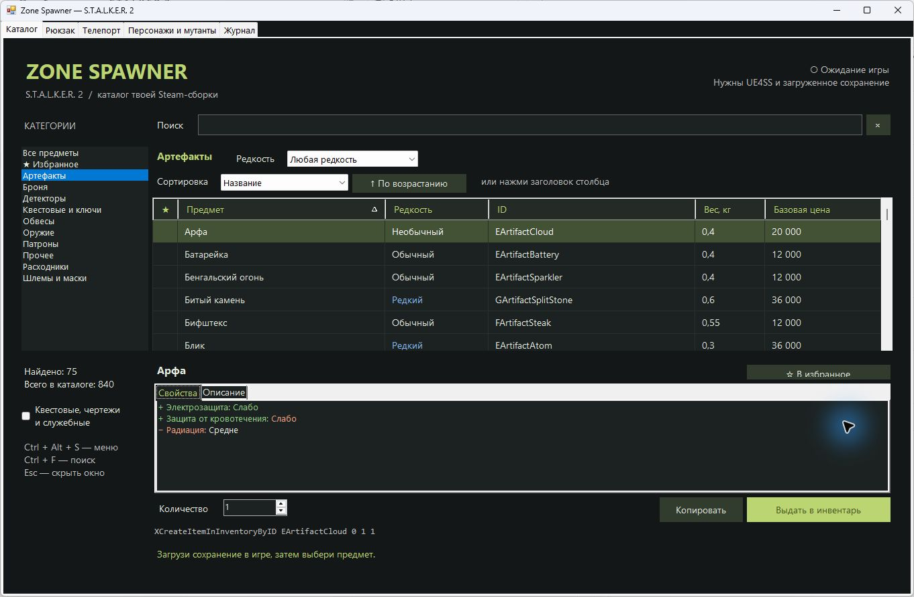
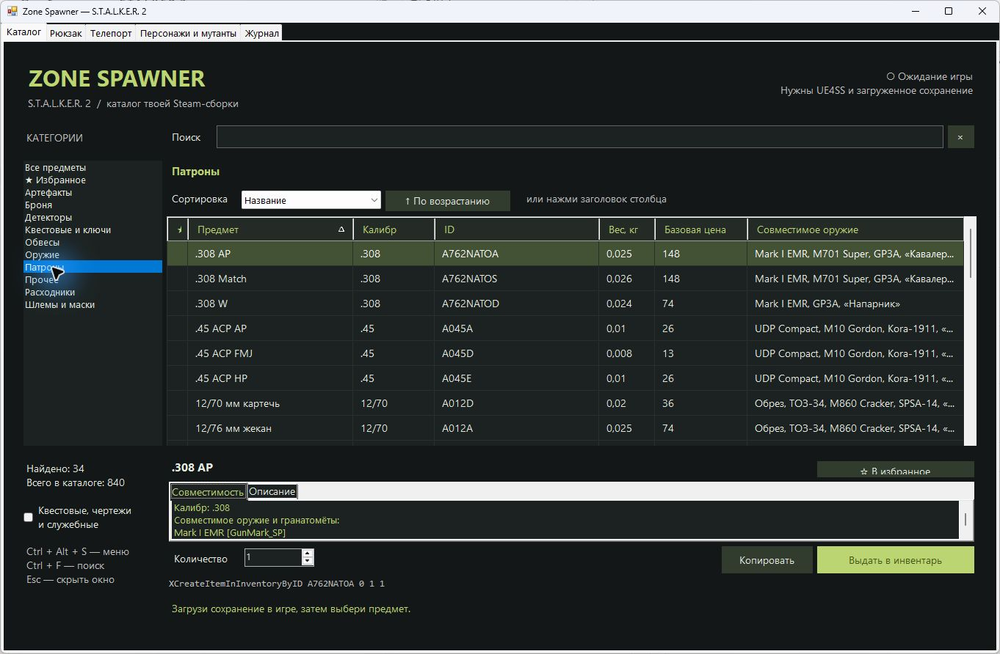
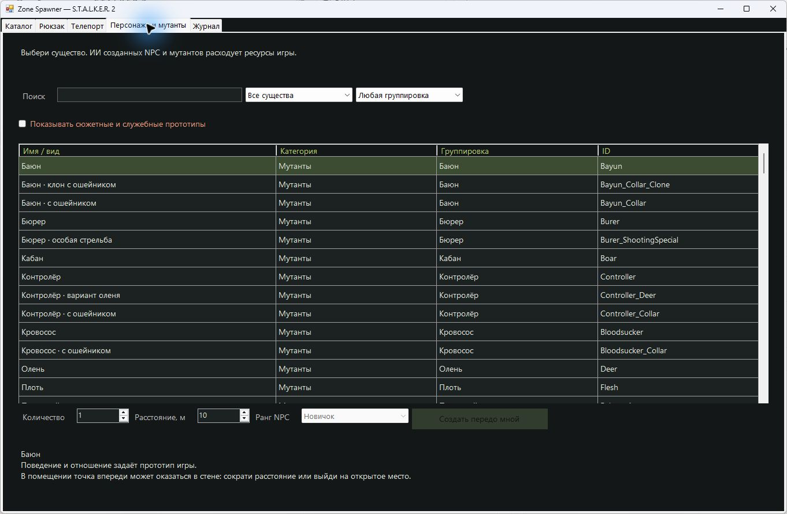
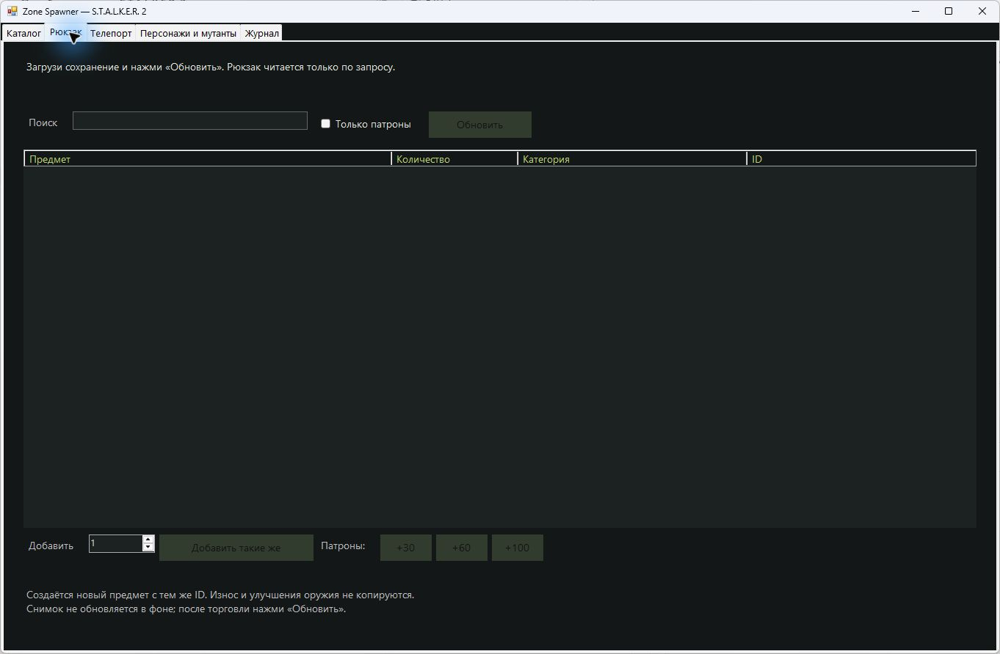
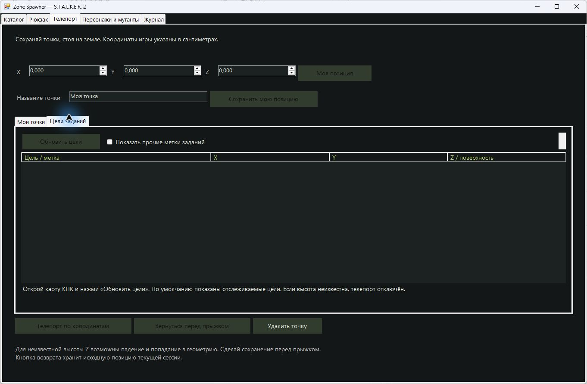

# Zone Spawner для S.T.A.L.K.E.R. 2

Отдельное Windows-меню для выдачи предметов, чтения рюкзака, телепортации и спауна персонажей/мутантов через UE4SS. Интерфейс на русском, исходники открыты по MIT.

**Проверенная конфигурация:** Steam build **25382007**, UE **5.5.4**, UE4SS **3.0.1 experimental 1028** + фикс **1.2**. Это предварительная версия для указанной сборки: установщик отклоняет другой исполняемый файл игры.



## Возможности

| Раздел | Что доступно |
| --- | --- |
| Каталог | 840 ID, 300 предметов по умолчанию; поиск по названию/ID, количество 1–999, избранное |
| Артефакты | 75 профилей, 4 редкости, базовые эффекты и описание особых механик; редкость применяется только к артефактам |
| Оружие | Калибр 69 огнестрельных моделей, включая уникальные; поиск и сортировка по калибру |
| Патроны и обвесы | Совместимость в таблице, карточке и подсказке; поиск по названию/ID оружия; 31 список боеприпасов и 47 обычных обвесов |
| Рюкзак | Реальные количества, поиск, «Добавить такие же», патроны +30/+60/+100; чтение по запросу |
| Телепорт | Моя позиция, свои точки, возврат перед прыжком, координаты отслеживаемых целей из открытой карты КПК |
| Персонажи и мутанты | 1635 прототипов, 161 доступен по умолчанию; фильтры, количество 1–5, дистанция 5–100 м и ранг NPC |
| Журнал | Последние 100 действий текущего сеанса меню |

Меню открывается по **Ctrl + Alt + S**, запускается скрытым вместе с игрой и завершает работу после её закрытия. Автозапуск Windows не нужен.

## Установка

1. Скачай пакет из [Releases](https://github.com/sergeysrnd/zone-spawner-stalker2/releases) или **Code → Download ZIP** и распакуй в постоянную папку.
2. Отдельно скачай точные версии UE4SS и фикса, указанные в [инструкции установки](docs/INSTALL.md).
3. Закрой игру и выполни `Install.ps1` в PowerShell 7 с путём к игре и двум архивам.
4. Запусти игру обычной кнопкой Steam, загрузи сохранение и нажми **Ctrl + Alt + S**.

Подробности: **[установка и удаление](docs/INSTALL.md)** · **[использование](docs/USAGE.md)** · **[неполадки](docs/TROUBLESHOOTING.md)** · **[сборка и проверки](docs/DEVELOPMENT.md)**.

## Скриншоты

Показана настоящая публикационная сборка при закрытой игре. Калибры, эффекты и совместимость читаются из каталога. Пустые игровые вкладки не выданы за живые результаты.

### Артефакты



### Патроны



### Персонажи и мутанты



### Рюкзак и цели заданий





## Производительность и ограничения

Скрытое меню не запускает постоянный опрос UObject или игрового потока. Рюкзак и метки читаются небольшими порциями по запросу; скрытие отменяет чтение. Карточки предметов не вызывают игру.

В одном 34-секундном сравнении в неподвижном ракурсе средний FPS движка составил **118,6 до чтения → 120,2 во время → 119,5 после**. Просадка в этом проходе не обнаружена; это не гарантия для всех сцен и не сравнение игры до/после установки UE4SS. Метод и пределы: [Производительность.txt](Производительность.txt).

- «Команда выдана игре» подтверждает вызов команды, а не фактический результат для любого прототипа.
- Рюкзак читает 1373 известных ID текущей игры; новые ID других модов могут отсутствовать. Износ и улучшения оружия не копируются.
- Калибр/совместимость относятся к базовым прототипам. Для A762D/A762A/A762E подтверждённый список оружия отсутствует.
- Цели заданий представлены типом и номером метки: названия заданий пока недоступны. Неизвестная Z блокирует телепорт; загруженная поверхность может оказаться крышей или другим этажом.
- Созданные NPC нагружают ИИ. Копия сюжетного NPC не восстанавливает его исходные квестовые связи.
- Полные игровые описания в пакет не включены; их можно импортировать из собственной игры. Файлы игры, UE4SS и фикса не распространяются вместе с проектом.

## Для разработчиков

WinForms / .NET Framework x64 + собственный Lua-мост UE4SS. Небольшая Win32 DLL запускает меню с PID игры. Для работы готовой сборки дополнительный .NET Runtime не требуется.

```powershell
./Build.ps1
./BuildNative.ps1 -TccDirectory 'D:\Tools\tcc'
python -m pip install -r tests/requirements.txt
./Test.ps1
```

[Лицензия MIT](LICENSE) действует на собственный код; [источники и сторонние лицензии](THIRD_PARTY_NOTICES.md) указаны отдельно. Независимый проект, не официальный продукт GSC Game World.

**English:** Russian-language open-source Windows item spawner for the Steam build listed above. It includes artifact effects, weapon calibers, ammunition compatibility, on-demand backpack reads, saved teleports and PDA quest markers. See the linked installation/use guides; other builds are not automatically supported.
