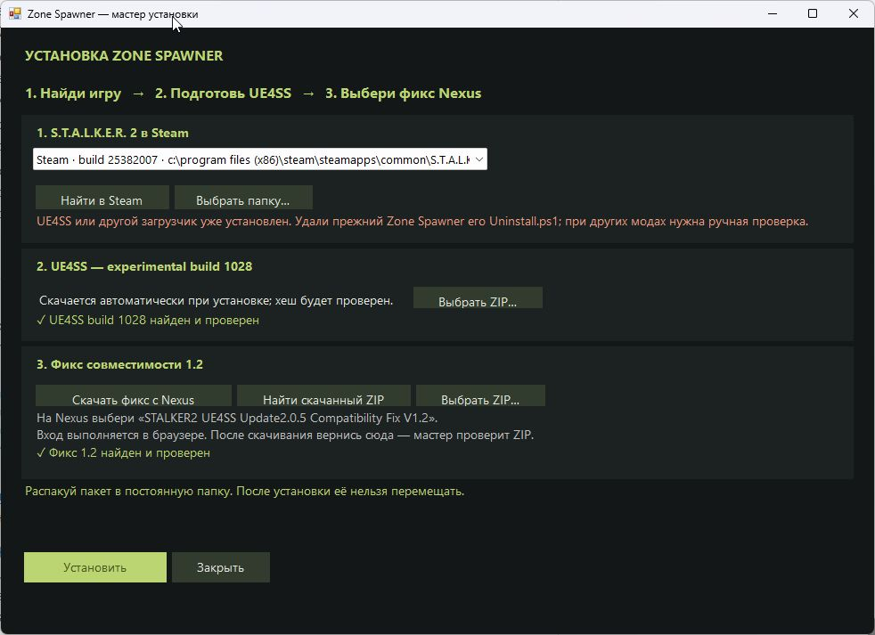

# Установка, обновление и удаление

[Установить впервые](#first-install) · [Обновить работающее меню](#update) · [Удалить мод](#remove) · [Решить проблему](TROUBLESHOOTING.md)

## Подойдёт ли мод моей игре

Нужны **Windows x64** и установленная **Steam-версия S.T.A.L.K.E.R. 2**. Установщик проверен для сборки Steam **25382007**, движок **UE 5.5.4**. Поддержка других обновлений пока не подтверждена.

Заранее искать технические номера не обязательно: мастер проверит установленную игру сам. Если он сообщает **«Сборка игры отличается от проверенной»**, этот пакет пока не подходит для автоматической установки на твою версию. [Что делать в этом случае](TROUBLESHOOTING.md#version).

**UE4SS** — загрузчик модов, через который меню передаёт действия игре. Мастер скачает его автоматически. **Фикс 1.2** — нужное для этой установки исправление совместимости UE4SS; его нужно скачать с Nexus Mods в браузере.

<a id="first-install"></a>
## Первая установка

### 1. Скачай и распакуй пакет

**[Скачать ZoneSpawner-v0.4.3-preview-win64.zip](https://github.com/sergeysrnd/zone-spawner-stalker2/releases/download/v0.4.3-preview/ZoneSpawner-v0.4.3-preview-win64.zip)**

Если открываешь [страницу релиза](https://github.com/sergeysrnd/zone-spawner-stalker2/releases/tag/v0.4.3-preview) вручную, раскрой **Assets** и выбери файл с этим названием.

Полностью распакуй ZIP в папку, которую собираешься оставить на месте, например `D:\Mods\ZoneSpawner`. Внутри должны лежать `ZoneSpawner.Setup.exe`, `ZoneSpawner.exe` и остальные файлы пакета. Запускай мастер из распакованной папки.

После установки игра использует эту папку. При её перемещении или удалении меню перестанет запускаться по прежнему пути.

### 2. Закрой игру и открой мастер

Закрой S.T.A.L.K.E.R. 2. Если меню уже работает, нажми правой кнопкой на его значок возле часов Windows и выбери **«Завершить»**.

Дважды нажми **`ZoneSpawner.Setup.exe`**. Он найдёт библиотеки Steam, в том числе на других дисках. При нескольких копиях выбери нужную из списка.

Если игра не найдена, нажми **«Выбрать папку…»** и укажи её корневую папку — обычно она называется `S.T.A.L.K.E.R. 2 Heart of Chornobyl`. Внутри неё есть папка `Stalker2`. Дождись сообщения о подходящей сборке.

Если мастер обнаружил уже установленный UE4SS, переходи к [обновлению](#update) или [разбору этой ситуации](TROUBLESHOOTING.md#existing-loader).

### 3. Скачай фикс с Nexus Mods

1. В мастере нажми **«Скачать фикс с Nexus»**.
2. На странице автора найди файл **STALKER2 UE4SS Update2.0.5 Compatibility Fix V1.2**. Для скачивания Nexus может попросить войти в учётную запись.
3. Дождись скачивания ZIP и вернись в мастер. Архив фикса распаковывать не нужно: мастер использует его целиком.
4. Должно появиться сообщение **«Фикс 1.2 найден и проверен»**. Если его нет, нажми **«Найти скачанный ZIP»** либо **«Выбрать ZIP…»** в разделе фикса и укажи скачанный архив.

Страница автора: [фикс UE4SS на Nexus Mods](https://www.nexusmods.com/stalker2heartofchornobyl/mods/2341?tab=files). Вход выполняется на сайте; пароль в установщик вводить не требуется.

### 4. Нажми «Установить»

Мастер сам скачает нужный UE4SS, проверит файлы и установит загрузчик, фикс и спаунер. Дождись сообщения **«Установка завершена»**.

Если для записи в папку игры не хватает прав, мастер предложит **«Перезапустить от администратора»**. Нажми эту кнопку и подтверди запрос Windows, если согласен с установкой.



На снимке показан другой возможный результат проверки: загрузчик уже найден, повторная установка остановлена.

### 5. Открой меню в игре

Нажми **«Запустить игру»** или используй обычную кнопку запуска в Steam. Загрузи сохранение и нажми **Ctrl + Alt + S**. Статус **«Игра подключена»** означает, что можно выдавать предметы.

Для пробы: **Каталог → найди «Аптечка» → количество 1 → «Выдать в инвентарь»**. Затем проверь рюкзак персонажа. [Другие действия](USAGE.md).

Для установки через мастер дополнительные PowerShell и .NET Runtime не нужны. Меню запускается вместе с игрой; добавлять его в автозапуск Windows не требуется.

<a id="update"></a>
## Обновление уже установленного меню

### С версии 0.4.1 или 0.4.2 на 0.4.3

1. Закрой игру и полностью заверши меню через значок возле часов → **«Завершить»**.
2. Скачай и распакуй новый ZIP отдельно.
3. Скопируй из него в **прежнюю установленную папку Zone Spawner** следующие файлы и согласись на их замену:

   - `ZoneSpawner.exe`
   - `locations.json` и `locations-info.json`
   - `door-codes.json` и `door-codes-info.json`

4. Запусти игру через Steam и открой меню клавишами **Ctrl + Alt + S**.

Для этого обновления UE4SS переустанавливать не нужно. Оставь на месте `installed-manifest.json` — файл с данными установки, `favorites.txt` — избранное, `teleport-points.json` — свои точки. Если ты импортировал полные игровые описания, сохрани свой `items.json`.

Новая версия меню сама по себе не расширяет совместимость загрузчика с новыми патчами игры.

### Более ранняя версия или замена самого загрузчика

Полная переустановка требует отдельного порядка: сохрани избранное и свои точки, [удали прежнюю установку её собственным скриптом](#remove), затем пройди первую установку.

Если в этом же UE4SS работают другие моды, нужна ручная проверка общего загрузчика. Автоматический мастер не устанавливает Zone Spawner поверх существующего UE4SS.

<a id="remove"></a>
## Удаление

Удаление пока выполняется скриптом и требует **[PowerShell 7](https://github.com/PowerShell/PowerShell/releases)**. Обычной установки меню это требование не касается.

1. Закрой игру и заверши меню через значок возле часов → **«Завершить»**.
2. Открой PowerShell 7 и перейди в ту папку, из которой устанавливал мод. Например:

   ```powershell
   cd 'D:\Mods\ZoneSpawner'
   ```

3. Выполни:

   ```powershell
   ./Uninstall.ps1
   ```

Скрипт перенесёт установленные файлы в папку восстановления `removed-install-…`. Если какой-то установленный файл был изменён, удаление остановится и сообщит, какой именно.

Файлы других модов сохраняются, но удаление общего загрузчика может затронуть их запуск. Если пользуешься другими модами UE4SS, сначала проверь их зависимости. После успешного удаления папку пакета можно переместить или удалить самостоятельно.

## Дополнительные возможности

- **Полные игровые описания:** в публичный пакет входят названия, свойства и краткие пояснения. Полные тексты можно [необязательно импортировать из своей игры](DEVELOPMENT.md#import-descriptions); это отдельная процедура с Python и repak.
- **Установка без сети и командная строка:** [точные версии, контрольные суммы и параметры](DEVELOPMENT.md#advanced-installation).
- **Ошибка на любом шаге:** [таблица частых проблем](TROUBLESHOOTING.md).
