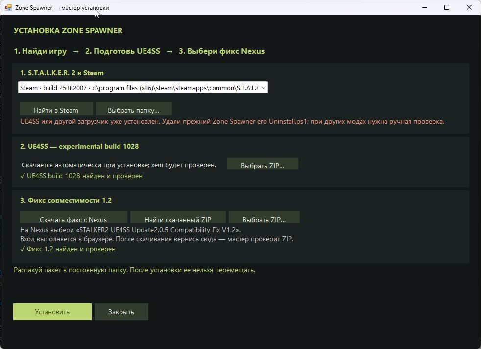

# Установка и удаление

## Требования

- Windows x64, лицензированная Steam-копия S.T.A.L.K.E.R. 2.
- Проверенная Steam-сборка **25382007**, движок **UE 5.5.4**.
- Обычная установка — двойным щелчком по `ZoneSpawner.Setup.exe`, без дополнительного .NET Runtime или PowerShell.
- [PowerShell 7](https://github.com/PowerShell/PowerShell/releases) нужен для скрипта удаления; это не требование мастера установки.
- Постоянная папка пакета с доступом на запись, например `D:\Mods\ZoneSpawner`.

Установщик проверяет SHA-256 `Stalker2-Win64-Shipping.exe`:

```text
61BC1E030740CEBC30CF1DAD0C86CF65E39E12FF0500225821D684181E08D56B
```

При другом хеше сначала требуется проверить совместимость загрузчика и обновить каталог. Обход этой проверки не является поддерживаемой установкой.

## Скачивание

1. Скачай **ZoneSpawner-v0.4.1-preview-win64.zip** из [Releases](https://github.com/sergeysrnd/zone-spawner-stalker2/releases). Альтернатива — **Code → Download ZIP**: готовые EXE/DLL находятся в корне вместе с исходниками.
2. UE4SS build 1028 мастер скачает сам с [официального GitHub](https://github.com/UE4SS-RE/RE-UE4SS/releases/download/experimental/UE4SS_v3.0.1-1028-gd7e7826d.zip), проверяя закреплённый хеш. Можно выбрать уже скачанный ZIP для установки без сети.
3. Фикс скачивается через кнопку Nexus: нужен файл **«STALKER2 UE4SS Update2.0.5 Compatibility Fix V1.2»** на [странице автора](https://www.nexusmods.com/stalker2heartofchornobyl/mods/2341?tab=files). Nexus может потребовать входа; он выполняется в браузере, а не в мастере.

| Архив | SHA-256, ожидаемый установщиком |
| --- | --- |
| UE4SS build 1028 | `342D893C3F64CB36B88AC4D58CEFC1DD8571B9E37B03F86B793F63955CCC2C0B` |
| Фикс 1.2 | `DC46D795F1DD134FE3E760BAE196ECFEA495BBD7D53A657A2CA5BA0D5CBA405A` |

Если точный архив недоступен или хеш отличается, остановись на этом этапе: другая версия требует проверки.

## Установка через мастер

1. Распакуй Zone Spawner в постоянную папку. Не перемещай её после установки: мост использует абсолютные пути.
2. Закрой игру. Если меню запускалось вручную, заверши его через трей → «Завершить».
3. Запусти `ZoneSpawner.Setup.exe`. Игра ищется по реестру Steam, `libraryfolders.vdf` и `appmanifest_1643320.acf`, включая библиотеки на других дисках. Можно выбрать найденную копию или указать папку вручную.
4. Дождись проверки сборки. При существующем `dwmapi.dll` / `ue4ss` или другой сборке установка заблокирована.
5. Если фикс ещё не найден, нажми **«Скачать фикс с Nexus»**, скачай именно V1.2 и вернись в мастер. Проверяются ZIP в папке загрузок, в кеше и в необязательной `dependencies` рядом с пакетом. Есть кнопки **«Найти скачанный ZIP»** и **«Выбрать ZIP»**.
6. После проверки фикса нажми **«Установить»**. UE4SS скачивается автоматически, либо используется проверенный ZIP из кеша. Мастер распаковывает архивы, применяет фикс/настройки, сохраняет лицензии, ставит Lua-мод и проверяет скопированные файлы.
7. Для защищённой библиотеки вроде Program Files могут понадобиться права администратора. При отказе доступа появится **«Перезапустить от администратора»**; запрос Windows подтверждает сам пользователь.
8. Нажми **«Запустить игру»** или запусти её через Steam, загрузи сохранение и нажми **Ctrl + Alt + S**.



Архивы кешируются в `%LOCALAPPDATA%\ZoneSpawner\Downloads`. Нет постоянного поиска загрузок: он выполняется при открытии мастера, возвращении из Nexus и нажатии кнопки. Мастер установки не добавляется в автозапуск Windows.

Отмена загрузки удаляет незавершённый `.part`. Если ошибка произошла после переноса файлов в игру, мастер возвращает их в свою папку восстановления `.zs-install-…` в Win64. Исходный EXE игры не меняется. Уже существующий загрузчик и посторонние моды автоматически не заменяются.

## Установка из командной строки — необязательно

`Install.ps1` использует тот же код установки, что и мастер. Без параметров он открывает мастер. Старый способ с явными путями поддерживается:

```powershell
./Install.ps1 `
  -GameRoot 'D:\SteamLibrary\steamapps\common\S.T.A.L.K.E.R. 2 Heart of Chornobyl' `
  -BaseArchive 'D:\Downloads\UE4SS_v3.0.1-1028-gd7e7826d.zip' `
  -FixArchive 'D:\Downloads\UE4SS-Fix-1.2.zip'
```

Имя файла фикса может отличаться — укажи настоящий путь. Параметр `BaseArchive` можно опустить: UE4SS будет скачан автоматически. При единственной найденной Steam-копии можно опустить `GameRoot`. Фикс должен быть выбран или найден локально.

Установщик проверяет архивы, задаёт закреплённые настройки совместимости, ставит Lua-мод и записывает `installed-manifest.json`. Оригинальные файлы игры не заменяются.

После установки в меню должен появиться статус «Игра подключена», когда сохранение загружено.

## Полные игровые описания — необязательно

В публичном каталоге оставлены идентификаторы и параметры; полный текст описаний извлекается локально. Для импорта нужны Python 3.11+ и официальный [repak](https://github.com/trumank/repak/releases).

Закрой меню и выполни в папке пакета:

```powershell
python ./tools/import_descriptions.py `
  --game-root 'D:\SteamLibrary\steamapps\common\S.T.A.L.K.E.R. 2 Heart of Chornobyl' `
  --repak 'D:\Tools\repak\repak.exe'
```

Скрипт проверяет сборку, читает русский `Game.locres` из своей игры и обновляет только локальный `items.json`. Повторная установка загрузчика не нужна. Не публикуй полученный файл с полным текстом описаний как часть этого репозитория.

## Обновление пакета

Закрой игру и меню. Сохрани `favorites.txt` и `teleport-points.json`, если пользуешься ими. Текущий установщик предназначен для чистой установки и не перезаписывает существующий UE4SS: удали прежнюю установку своим `Uninstall.ps1`, замени пакет и установи заново. Если есть другие моды в UE4SS, сначала согласуй обновление их общего загрузчика вручную.

## Удаление

Закрой игру и меню. В PowerShell 7 из папки, использованной для установки:

```powershell
./Uninstall.ps1
```

Установленные файлы переносятся в `removed-install-…`, а не стираются без возможности восстановления. Изменённые файлы останавливают удаление; посторонние моды сохраняются. После удаления папку пакета можно переместить или удалить самостоятельно.

Автозапуск Windows установщик не создаёт. `Autostart.ps1 -Mode Disable` нужен только для удаления старого ярлыка предыдущих версий.
